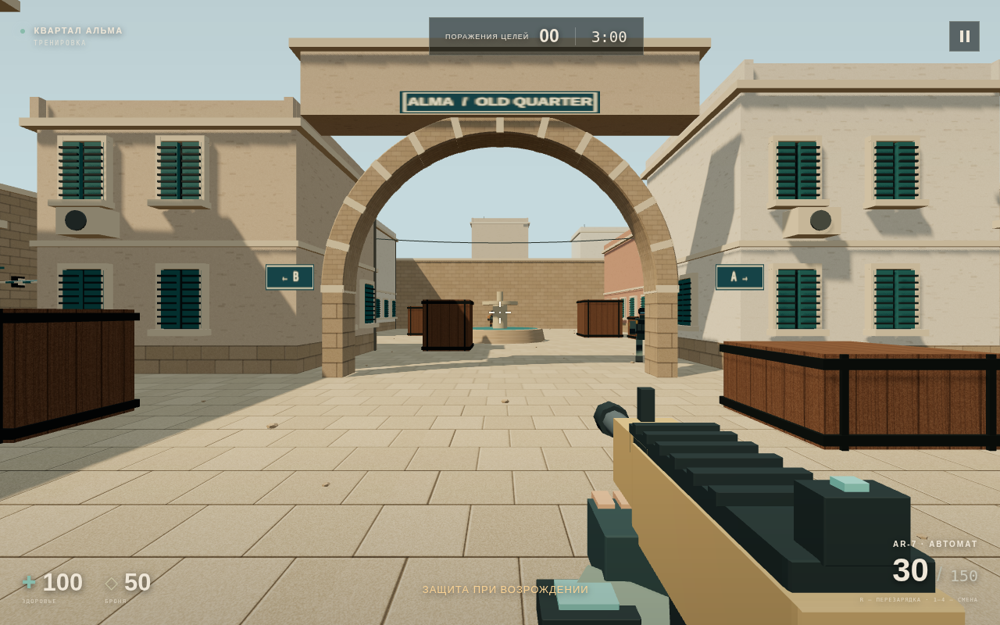

# Полигон · Сектор 07

Теперь в проекте есть **игра от первого лица с трёхмерной картой**, которую можно открыть в браузере. Для проверки на компьютере не нужны Ubuntu, терминал или компиляция.

## Как запустить на Windows

1. Скачай свежий архив через **Code → Download ZIP** на странице репозитория.
2. Нажми на ZIP правой кнопкой → **Извлечь всё… → Извлечь**. Распакуй архив целиком.
3. Открой полученную папку. Если внутри ещё одна папка, зайди в неё.
4. Найди **`START_GAME.html`** и открой двойным щелчком. Если Windows спрашивает программу, выбери **Google Chrome** или **Microsoft Edge**.
5. На экране меню нажми **«Начать тренировку»**. Браузер захватит мышь для обзора; **Esc** вернёт курсор.

Файл запуска открывает `web/index.html`. Все игровые файлы и графическая библиотека входят в архив: после скачивания соединение с интернетом для игры на компьютере не требуется. Не перемещай один HTML-файл отдельно от остальных папок. Для 3D нужен браузер с доступным WebGL и включённым аппаратным ускорением.



## Что уже можно проверить

- Собственная карта **«Квартал Альма»**: каменные арки, рыночная улица, двор с фонтаном, боковые маршруты, текстурированная кладка и штукатурка, ставни и детали фасадов.
- Ходьба, обзор, прыжок, приседание, столкновения с картой и приближение при прицеливании.
- Четыре противника с перемещением и стрельбой, трёхминутная тренировка, здоровье, броня, счёт и возрождение.
- Автомат, пистолет, дробовик и снайперская винтовка: попадания лучами, отдача, разброс, перезарядка и смена оружия.
- Округлые модели персонажей, пальцы и перчатки, камуфляжная ткань. Оружие моделируется в Blender: фаски, скобы, затворы, оптика и отдельные магазины. Есть анимации ходьбы, выстрела, перезарядки, осмотра и падения.
- Металл с отражениями, отдельные карты цвета, нормалей и шероховатости, оригинальная отделка Tidal Alloy. Бетон и штукатурка имеют сколы, поры и трещины. Следы выстрелов остаются на стенах и полу (до 96 на компьютере и 48 на сенсорном профиле), очищаются при новом раунде.
- Звуки, индикатор попадания, вспышка выстрела, HUD и управление для сенсорного экрана.

ЛКМ обрабатывается на уровне документа, включая сенсорный слой на гибридных компьютерах. Короткие нажатия сохраняются до ближайшего игрового тика.

Модели созданы из собственного исходника и включены в архив. Blender нужен только для их редактирования; игроку ничего устанавливать не требуется. Материалы и анимации создаются локально, без внешних загрузок.

## Управление

| Действие | Компьютер |
| --- | --- |
| Движение | W, A, S, D |
| Обзор | Мышь |
| Стрельба | Левая кнопка мыши |
| Прицеливание | Правая кнопка мыши |
| Перезарядка | R |
| Прыжок | Пробел |
| Приседание | C или левый Ctrl, удерживать |
| Выбор оружия | 1 — автомат; 2 — пистолет; 3 — дробовик; 4 — винтовка |
| Следующее оружие | Q |
| Осмотреть оружие | F |
| Пауза / освободить мышь | Esc или кнопка паузы |

На телефоне левый джойстик отвечает за движение, движение пальцем по правой области — за обзор. Круглые кнопки позволяют стрелять, перезаряжать, прыгать, приседать и переключать оружие. Удобнее играть в горизонтальном положении. Кнопка «+» включает приближение при удержании.

## Как проверить на телефоне

Браузерная версия поддерживает сенсорное управление. **APK пока нет.** Для телефона надёжнее открыть игру по HTTP/HTTPS: открытие локальных HTML-файлов зависит от браузера и файлового менеджера.

Можно разместить папку проекта на обычном статическом хостинге. Для проверки в домашней Wi-Fi сети можно временно раздавать её с компьютера:

1. Подключи компьютер и телефон к одной Wi-Fi сети.
2. Установи Python 3 на компьютер, если его нет, и открой терминал в папке с `START_GAME.html`.
3. Запусти:
   ```sh
   python3 -m http.server 8080 --bind 0.0.0.0
   ```
   Если на Windows команда `python3` не найдена, используй:
   ```powershell
   py -m http.server 8080 --bind 0.0.0.0
   ```
4. Узнай локальный IPv4-адрес компьютера: в Windows команда `ipconfig`, раздел подключённого Wi-Fi адаптера. Пример адреса — `192.168.1.10`.
5. На телефоне открой `http://192.168.1.10:8080/START_GAME.html`, заменив адрес на свой. Если брандмауэр Windows спрашивает доступ, разреши его для домашней частной сети.
6. Оставь терминал работающим, пока играешь. **Ctrl+C** останавливает раздачу файлов.

Для этого способа запускай сервер непосредственно на Windows; сервер внутри WSL может потребовать отдельной настройки сетевого доступа. Адрес `localhost` на телефоне указывает на сам телефон, поэтому нужен именно адрес компьютера в Wi-Fi сети.

## Устройство проекта

| Путь | Назначение |
| --- | --- |
| `START_GAME.html` | Открытие игры двойным щелчком |
| `web/index.html`, `web/style.css` | Меню, HUD и сенсорные элементы |
| `web/assets.js` | Карта, персонажи и процедурные анимации |
| `web/weapons.js`, `web/models/` | Меши оружия, материалы, руки и перчатки |
| `tools/build-weapons.py` | Редактируемый Blender-генератор моделей |
| `web/game.js` | Браузерная симуляция, управление, боты, стрельба, звук и рендер |
| `web/vendor/` | Локальная графическая библиотека и её лицензия |
| `src/`, `include/`, `tests/` | Отдельное C++-ядро и его тесты |

Браузерная игра написана на JavaScript и **пока не исполняет C++-ядро**. Это самостоятельная визуальная версия для быстрой проверки карты и механик на компьютере и телефоне. В ней локальная тренировка с ботами: сетевой матч, экономика покупок, режим установки устройства, аккаунты и сборка APK ещё не подключены. Не все возможности C++-ядра доступны в браузере.

Подробнее: [архитектура браузерного клиента и проверки](docs/web-client.md).

## C++-ядро для разработки

Самостоятельный прототип ядра мобильного тактического шутера на **C++17**. Параметры подобраны под жанр и ограничения мобильных устройств 2017–2019 годов. Внешних зависимостей нет; нужны компилятор C++17 и GNU Make.

### Сборка и проверка C++

Из корня репозитория:

```sh
make -j2
make test
make demo
make sanitize
```

`make test` запускает четыре набора проверок. `make demo` моделирует 90 тиков: клиент отправляет команды, сервер проверяет выстрелы, клиент принимает снимки. Ожидаемый результат: одно убийство, 1100 денег, 8 патронов в магазине, ноль неподтверждённых команд. Демонстрация завершается ненулевым кодом при расхождении. `make sanitize` выполняет тесты с AddressSanitizer и UndefinedBehaviorSanitizer в отдельном каталоге.

### Системы C++

| Система | Реализация |
| --- | --- |
| Игрок | Стрейф, ускорение/торможение, гравитация, прыжок по нажатию, приседание с проверкой потолка, AABB-коллизии, здоровье, броня, инвентарь |
| Оружие | Базовый `Weapon`, четыре наследника, hitscan, разброс от движения/стойки/серии, паттерны отдачи, магазин и резерв, перезарядка, задержка смены |
| Экономика | Покупка в разрешённой фазе и зоне, проверка средств, награды за убийства и раунды, ограничение баланса |
| Режимы | TDM с возрождением и счётом; Defuse с переносом, установкой, подбором и обезвреживанием устройства, таймерами и сменой раундов |
| Синхронизация | Сервер 30 Гц, очередь ввода с проверками, авторитетные попадания, снимки, предсказание движения и повтор неподтверждённых команд, интерполяция удалённых позиций |

Полная [архитектура и оптимизации](docs/architecture.md) описывает взаимодействие ядра, физики, сети, ввода, рендера и игровой логики. Там же находятся псевдокод сенсорного управления, цикла кадров, графического backend и UDP-транспорта.

### Ключевые методы C++

- [`Player::UpdateMovement()`](src/player.cpp): преобразование ввода через yaw, ограничение скорости, проверка опоры и габаритов, прыжок и разрешение столкновений по осям.
- [`Weapon::Shoot()` и `ApplyRecoil()`](src/weapon.cpp): проверки боезапаса и задержек, вычисление конуса разброса, генерация лучей и изменение углов камеры.
- [`Server::ServerProcessHit()`](src/network.cpp): ближайшее пересечение с картой или игроком, броня, урон, смерть и выдача награды. Клиентские координаты попадания и величина урона не принимаются.
- [`Match::BuyWeapon()`](src/match.cpp): проверка покупки и выдача оружия с однократным списанием денег.
- [Общие типы и интерфейсы](include/retro/engine.hpp).

Пример взаимодействия модулей:

```cpp
using namespace retro;
World map{{{{-20,-1,-20}, {20,0,20}}}};
Server server(map, Mode::Tdm);
server.players.emplace_back(1, Team::Attackers);
server.players.emplace_back(2, Team::Defenders);
server.players[1].state.position = {0,0,5};

Command input;
input.sequence = 1;
input.input.fire = true;
// ID берётся из аутентифицированного соединения, не из payload клиента.
if (server.ReceiveCommand(1, input)) {
    server.Tick();
    Snapshot snapshot = server.GetSnapshot(1);
    // Передать snapshot клиенту; Reconcile() исправит предсказанное движение.
}
```

`Shoot()` вызывается сервером у текущего оружия; код сервера сам задаёт источник луча, урон, дальность, seed и темп стрельбы. `ApplyRecoil()` изменяет yaw/pitch. Клиент должен формировать следующий абсолютный угол из камеры с учтённой отдачей; компенсация встречным движением мыши допускается.

### Границы C++-ядра

Сетевая модель выполняется внутри одного процесса. Настоящие сокеты, handshake и кодирование пакетов даны псевдокодом. Предсказание охватывает движение; снимки боезапаса, состояния раунда и события оружия нужно добавить для полноценного клиента. Компенсация сетевой задержки при попаданиях отсутствует.

C++-ядро не подключено к графическому backend и платформенным адаптерам. Графика, ассеты, звук и управление реализованы в отдельном браузерном прототипе выше. Сборок Android/iOS пока нет. В C++ работают фиксированный шаг, простая физика и hitscan; обход геометрии пока линейный.

Экономика намеренно упрощена: после возрождения каждый получает новый пистолет, деньги сохраняются; TDM не имеет магазина. Нет наклонных поверхностей, ступенек, столкновений игроков друг с другом, отдельных хитбоксов головы, пробитий и дымовых гранат. Это исходная база для дальнейшей разработки, а не готовая мобильная игра.

## Ссылка для телефона через GitHub Pages

Для публикации только браузерной версии разработчик запускает `python3 tools/publish-pages.py --push`. Скрипт отправляет содержимое `web/` в корень ветки `gh-pages`, сохраняя историю предыдущих публикаций и не меняя рабочую папку.

Один раз в репозитории открой **Settings → Pages → Build and deployment → Source: Deploy from a branch**, выбери **gh-pages**, папку **/(root)** и нажми **Save**. Когда сборка Pages завершится, HTTPS-ссылка на игру появится в этом разделе. Её можно открыть в Яндекс Браузере, Chrome или Safari на телефоне. Это локальная тренировка с ботами; аккаунт для игры не требуется.

Повторная отправка через скрипт обновляет сайт. В `version.json` на сайте записан исходный коммит. Включение Pages и успешная сборка проверяются отдельно от отправки ветки.
