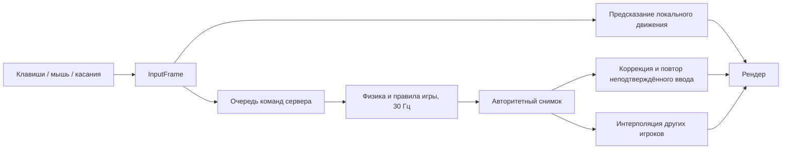

# Архитектура мобильного тактического FPS

Это самостоятельная модель механик мобильных шутеров 2017–2019 годов. Размеры, скорости, стоимость оружия и таймеры — выбранные для прототипа параметры. Код моделирует игровой мир без графического окна; платформенный ввод, рендеринг и транспорт ниже описаны псевдокодом.

## Модули и поток данных

| Модуль | Ответственность | Основные данные |
| --- | --- | --- |
| Ядро | Фиксированный шаг симуляции, порядок обновления, время, запуск тестов | `kTickDt = 1 / 30`, номер тика |
| Ввод | Превращение клавиш, мыши и касаний в одинаковые команды | `InputFrame`, `Command` |
| Физика | Движение, гравитация, пересечения AABB и лучей | `Vec3`, `Aabb`, `World` |
| Игровая логика | Игроки, оружие, урон, покупки, командные режимы | `Player`, `Weapon`, `Match` |
| Синхронизация | Авторитетная симуляция, подтверждения ввода, prediction и interpolation | `Server`, `Predictor`, `Interpolator`, `Snapshot` |
| Рендер | Камера, видимые меши, анимация оружия, интерфейс | Только визуальное представление состояния |
| Платформа | Окно, GLES, звук, UDP, часы и файловая система | Адаптеры к Android/iOS или настольной ОС |



Код общей симуляции пригоден для клиента и выделенного сервера. Рендер не меняет здоровье, позицию или деньги. Сервер сам вычисляет выстрелы и урон; клиент немедленно отображает ввод, а затем принимает серверную коррекцию. Один тик равен примерно 33,3 мс. Частота кадров может быть 30 или 60 Гц независимо от частоты симуляции.

## Фиксированный шаг

Время кадра нельзя передавать напрямую в движение: иначе поведение будет зависеть от производительности устройства, а большой кадр позволит перескочить через коллизию. Клиент использует накопитель и ограничивает объём работы после паузы приложения:

```cpp
// Псевдокод платформенного цикла клиента.
constexpr double tick = 1.0 / 30.0;
double accumulator = 0;
while (running) {
    const double elapsed = monotonicClockDelta();
    accumulator += clamp(elapsed, 0.0, 0.25);
    pollPlatformEvents();
    receiveAndApplySnapshots();

    int simulated = 0;
    while (accumulator >= tick && simulated < 5) {
        Command command = input.consumeNextTick(++sequence);
        predictor.Predict(command, collisionWorld);
        transport.sendInput(command); // хранить для подтверждения/повтора
        accumulator -= tick;
        ++simulated;
    }
    if (accumulator >= tick) {
        // Приложение не успевает: не отправлять огромный хвост старого ввода.
        accumulator = fmod(accumulator, tick);
        requestFreshStateIfNeeded();
    }
    render(accumulator / tick);
}
```

Выделенный сервер также вызывает `Server::Tick()` с постоянной частотой. Серверный планировщик использует монотонные часы; часы клиента не управляют симуляцией. При постоянной перегрузке нужны снижение нагрузки и диагностика длительности тика. Ускорять игровое время или бесконтрольно накапливать отставание нельзя. Политика пропуска времени после сворачивания клиента относится к платформенному циклу, а не к правилам матча.

## Движение и коллизии

Ось Y направлена вверх; позиция игрока задаёт точку у ног, единицы длины — метры. `yaw` и `pitch` измеряются в радианах. Движение вперёд и стрейф преобразуются через `yaw`; диагональный вектор нормализуется, поэтому две нажатые клавиши не увеличивают максимальную скорость.

Игрок — вертикальный AABB, карта — набор неподвижных AABB. Движение разрешается по осям с ограничением перемещения ближайшей поверхностью. Это даёт скольжение вдоль стен, приземление и остановку у потолка без полноценного решателя жёстких тел. Проверка опоры отделена от визуальной модели. Для прыжка необходимы опора и новое нажатие; удерживание кнопки не создаёт автоматическую серию прыжков.

Приседание меняет высоту коллайдера с 1,8 до 1,1 м и снижает скорость. Вставание разрешено, только если высокий AABB помещается в мире. Камера берёт высоту глаз из текущей стойки; графический адаптер может сглаживать переход камеры, сохраняя дискретное изменение физического коллайдера.

Выбранные параметры: скорость бега 5,2 м/с, приседания 2,7 м/с, начальная вертикальная скорость прыжка 6,8 м/с, гравитация 20 м/с². Это игровые настройки, а не попытка воспроизвести земную физику. Смена оружия блокирует стрельбу на 0,25 с.

Упрощение рассчитано на плоские поверхности и прямоугольные препятствия. Склоны, лестницы, движущиеся платформы, расталкивание игроков и исправление некорректного спавна внутри стены потребуют отдельных правил. Для реальной карты разумны капсула игрока, примитивная обработка ступенек и статическая сетка широкофазного поиска; они дороже текущей модели, но всё ещё существенно проще универсального физического движка.

## Оружие, попадания и урон

`Weapon` управляет магазином, резервом патронов, задержкой между выстрелами, перезарядкой и состоянием серии. `Pistol`, `Rifle`, `Sniper`, `Shotgun` задают характеристики и паттерн отдачи. Полуавтоматическое оружие требует отпустить спуск; автомат может продолжать очередь при удержании. Дробовик испускает несколько лучей за один расход патрона.

`Shoot()` проверяет возможность выстрела и формирует лучи от глаз игрока. До применения отдачи вычисляются направления текущего выстрела. Затем расходуется патрон, запускается задержка и `ApplyRecoil()` изменяет углы камеры. Такой порядок означает, что новый импульс отдачи влияет на последующие выстрелы; первый выстрел направлен по текущему прицелу. Паттерны детерминированы, а случайный разброс использует отдельный генератор с серверным seed.

Углы в `InputFrame` абсолютные: адаптер клиента должен учитывать импульс отдачи в текущих углах камеры перед созданием следующей команды. Если постоянно отправлять прежние углы, это фактически полностью компенсирует отдачу. Сервер допускает встречное движение прицела; защита от автоматической компенсации не входит в прототип. В полноценном клиенте визуальное предсказание отдачи и его подтверждение сервером требуют отдельной синхронизации.

| Оружие | Цена | Магазин + резерв | Урон одного луча | Интервал | Перезарядка |
| --- | ---: | ---: | ---: | ---: | ---: |
| Пистолет | 400 | 12 + 60 | 28 | 0,233 с | 1,5 с |
| Автомат | 2700 | 30 + 90 | 32 | 0,1 с | 2,2 с |
| Снайперская винтовка | 4500 | 5 + 25 | 105 | 1,1 с | 2,8 с |
| Дробовик | 1800 | 8 + 32 | 12 × 8 лучей | 0,8 с | 2,4 с |

Проверка задержек привязана к тикам: произвольный интервал будет округлён вверх до ближайшего доступного тика. Оптический прицел, анимация затвора и поснарядная перезарядка дробовика пока не реализованы.

Разброс состоит из базового значения, штрафа за движение, штрафа в воздухе и накопления серии; приседание уменьшает его. Величина разброса — угловая характеристика конуса. Для равномерного распределения в малом диске применяют `radius = sqrt(random01())`, а не равномерный радиус: иначе попадания чрезмерно концентрируются в центре. Визуальный размер прицела можно вычислять из той же величины, но он не участвует в определении попадания.

`ServerProcessHit()` вызывается для выстрела, сформированного серверной логикой оружия. Для каждого луча сравниваются ближайшая поверхность мира и пересечения с игроками. Стена перекрывает цель; сам стрелок и мёртвые игроки не получают урон повторно. Геометрия попадания в прототипе — один AABB на игрока. Отдельных множителей головы и конечностей, пробития стен, рикошетов и баллистики нет.

Броня поглощает часть обычного урона до исчерпания запаса. `TakeDamage()` сообщает переход из живого состояния в мёртвое, чтобы награда за убийство не выдавалась за каждый последующий луч дробовика. Проверку убийства, счёт и выплату проводит сервер.

## Экономика и режимы

Деньги — целочисленное серверное состояние с верхним пределом. Покупка проверяет фазу раунда, жизнь игрока, нахождение в зоне покупки, стоимость и наличие оружия в инвентаре. Списание денег и выдача оружия должны составлять одну операцию; клиент отправляет запрос покупки, а интерфейс показывает подтверждённый результат. В сетевом продукте запросы покупки и результаты раунда передаются с идентификаторами операций и защитой от повторного выполнения.

`Match` хранит три фазы: `Buy`, `Live`, `Finished`. В командном бою счёт растёт от убийств, цель — 25 убийств либо лучший счёт через 10 минут, возрождение происходит через 3 с. Ничья по истечении времени завершает матч без победителя и бонуса. Фазы покупки в этом режиме нет; стандартное вооружение — пистолет. Более богатый TDM loadout должен выдавать отдельный обработчик возрождения.

В режиме установки устройства действуют 15 с покупки, 115 с боя, установка за 3 с и таймер устройства 40 с. Обезвреживание занимает 5 с в радиусе 1,5 м. Удержание действия, положение, жизнь, опора и неподвижность проверяются игровыми правилами; любое нарушение прерывает накопление прогресса. Смерть нападающих после установки сама по себе не отменяет таймер устройства. Пауза между раундами составляет 5 с, после чего начинается следующая фаза покупки.

Первый нападающий становится носителем. При его гибели устройство падает в точке смерти; живой нападающий автоматически подбирает его в радиусе 1,5 м. Передача вручную, графическая модель устройства и интерфейс прогресса пока отсутствуют. `InputFrame` содержит команды покупки, установки и обезвреживания; сервер проверяет их в `Match`. Действие должно подтверждаться каждый тик: `Match::Tick()` сбрасывает прогресс, если в этом тике не было соответствующего вызова.

За убийство противника начисляется 300, за победу в раунде — 3250, проигравшим — 1400; максимальный баланс 16000. Возрождение сохраняет деньги, восстанавливает здоровье до 100 и выдаёт новый пистолет без брони. Оружие выживших между раундами здесь не сохраняется — это упрощение экономики. Предел числа раундов и смена сторон также оставлены расширению.

## Сеть: реализованная модель и транспорт

`Command` содержит номер команды и ввод, без авторитетной позиции, здоровья, денег или подтверждения попадания. `ReceiveCommand()` получает идентификатор уже аутентифицированного соединения отдельно от содержимого пакета. Подмена поля игрока в пакете не должна менять владельца соединения. Номер команды нужен для упорядочивания, отбрасывания повторов и подтверждения сервером.

Минимальная серверная защита включает проверку чисел на конечность, допустимых значений ввода и слотов, ограничения очередей и темпа обработки. Позицию и длительность шага задаёт сервер; оружие проверяет задержку, боезапас и перезарядку. Клиент не выбирает разброс и не сообщает серверу, кому нанести урон. Эти меры защищают основные правила симуляции, но не распознают автоматическое наведение, анализ изображения или другие внешние помощники.

За тик сервер извлекает не более одной команды на игрока; очередь ограничена восемью командами. Старые и повторные номера отбрасываются, допустимый скачок номера ограничен 128. При пустой очереди используется нейтральный ввод с сохранением углов: движение затухает по обычным правилам, удержание спуска прекращается. Поэтому пакетный флуд не ускоряет симуляцию, а недостаток команд влияет на отзывчивость до получения нового состояния. Переполнение 32-битного номера внутри сессии не поддерживается; до него сессию необходимо переинициализировать.

Порядок тика: приём команд, таймеры оружия и движение всех игроков; затем покупки, смена, перезарядка и выстрелы; затем взаимодействие с устройством и общий `Match::Tick()`. Все выстрелы проверяют хитбоксы одного завершённого шага движения. Урон применяется последовательно: игрок, погибший от более раннего выстрела этого тика, уже не стреляет. Для соревновательного продукта нужно отдельно определить одновременность смертельных выстрелов. Гибель в текущем тике прерывает установку и обезвреживание.

В текущем C++ коде передача команд и снимков идёт через вызовы методов в памяти процесса. Сокеты, формат пакета, шифрование и обработка потерь — область следующего платформенного слоя. Нельзя сериализовать структуры C++ через `memcpy`: padding, размеры enum и порядок байтов не являются сетевым контрактом.

```cpp
// Псевдокод приёма UDP-пакета.
onDatagram(bytes, source) {
    if (bytes.size() > configuredPacketLimit) return;
    auto envelope = decodeBoundedEnvelope(bytes); // версия, длина, тип
    if (!envelope || !session.verifyAuthentication(envelope, source)) return;
    auto connection = session.connectionFor(envelope); // серверный mapping
    if (!connection.rateLimit.accept(bytes.size())) return;

    if (envelope.type == InputBatch) {
        // Поля кодируются явно; количество команд ограничено.
        for (auto command : decodeBoundedCommands(envelope))
            server.ReceiveCommand(connection.playerId, command);
    }
    if (envelope.type == ReliableAction) {
        // Покупка и другие одноразовые действия: ID + дедупликация + ACK.
        reliable.applyOnce(connection, envelope.actionId, envelope.payload);
    }
}
```

Практичный транспорт добавляет несколько последних неподтверждённых команд к свежему пакету: потеря одного UDP-пакета тогда не обязательно создаёт дырку во вводе. Снимки состояния можно пересылать без гарантированной доставки, отбрасывая старые; критические события используют повтор до ACK с пределом времени. Нужны лимит размера пакета, защита от replay, ограничение скорости, тайм-аут соединения и согласованная политика пропущенных команд. Сессионный ключ и безопасный handshake берутся из проверенного транспортного решения, а не из самодельного шифрования.

### Предсказание и коррекция

Клиент сохраняет неподтверждённые команды и немедленно вызывает `Predictor::Predict()`. При получении снимка он устанавливает авторитетное состояние собственного игрока, удаляет команды до `acknowledgedSequence` включительно и повторяет оставшиеся команды тем же фиксированным шагом. Физическая позиция исправляется сразу; графический слой может отдельно сглаживать визуальную ошибку, не используя её как состояние коллизий.

```cpp
// Схема коррекции движения.
local.state = snapshot.stateFor(local.id);
discardPendingCommandsThrough(snapshot.acknowledgedSequence);
for (const Command& command : pendingCommands)
    local.UpdateMovement(command.input, kTickDt, world);
```

Предсказание в прототипе относится к движению. Полноценный снимок оружия дополнительно должен содержать магазин, резерв, перезарядку, выбранный слот, задержку смены и подтверждённые события выстрела. Для мгновенных визуальных эффектов выстрела понадобятся ID предсказанного события и дедупликация при подтверждении. Иначе повтор симуляции может повторно воспроизвести звук или списать патрон.

Одинаковый код с `float` уменьшает расхождение клиента и сервера, но не гарантирует побитовый детерминизм на разных CPU/компиляторах. Авторитетные снимки и коррекция остаются необходимыми.

### Интерполяция удалённых игроков

Клиент отображает других игроков примерно на три тика, то есть 100 мс, позади оценённого серверного времени. `Interpolator` хранит несколько снимков и интерполирует положение между двумя известными моментами. Время отрисовки определяется синхронизацией часов и оценкой jitter, а не номером последнего полученного пакета напрямую:

```cpp
double renderTick = estimatedServerTickNow - 3.0;
auto position = interpolator.Position(remotePlayerId, renderTick);
// Аналогично интерполировать yaw по кратчайшей дуге; здоровье не смешивать.
```

Если свежего снимка нет, безопасный простой вариант — удерживать последнюю известную позицию; неограниченная экстраполяция позволяет игроку визуально уйти за стену. Смерть, возрождение и телепортация требуют маркера разрыва истории, иначе интерполяция может провести модель через карту. Эти визуальные правила относятся к расширению прототипа.

В текущей модели попадание проверяется по состоянию сервера в момент обработки выстрела. Компенсация задержки не реализована: игрок с высоким ping может промахнуться по движущейся цели, которую видел раньше. Возможное расширение — история AABB за ограниченное окно, проверка временной метки относительно серверных часов и raycast по историческим хитбоксам. Клиентская временная метка должна ограничиваться серверной оценкой задержки; произвольный rewind недопустим.

## Ввод: мышь, клавиатура и касания

Вся игровая логика получает одинаковый `InputFrame`. Настольный адаптер преобразует WASD в оси, пробел в прыжок, кнопку приседания в стойку, относительное движение мыши в углы, кнопки мыши в спуск и выбор режима прицеливания при его добавлении.

Для сенсорного экрана левая область управляет движением, правая — обзором. Нужен захват по ID касания, чтобы второй палец не «украл» джойстик; кнопки стрельбы, прыжка, приседания, смены и перезарядки обрабатываются независимо. Координаты нормализуются относительно области управления и safe area.

```cpp
// Псевдокод адаптера сенсорного ввода.
onTouchDown(id, point) {
    if (moveZone.contains(point) && !moveTouch)
        moveTouch = capture(id, point);
    else if (lookZone.contains(point) && !lookTouch)
        lookTouch = capture(id, point);
    else
        buttons.beginTouch(id, point);
}
onTouchMove(id, point) {
    if (id == moveTouch.id) {
        Vec2 axis = clampLength((point - moveTouch.origin) / joystickRadius, 1);
        input.strafe = applyDeadZone(axis.x);
        input.forward = -applyDeadZone(axis.y);
    }
    if (id == lookTouch.id) {
        Vec2 delta = point - lookTouch.previous;
        input.yaw = wrapRadians(input.yaw + delta.x * sensitivity);
        input.pitch = clamp(input.pitch - delta.y * sensitivity, minPitch, maxPitch);
        lookTouch.previous = point;
    }
}
onTouchEndOrCancel(id) { releaseCaptureAndResetItsControls(id); }
```

При потере фокуса все удержания сбрасываются. Дельты обзора потребляются ровно один раз; на нескольких симуляционных тиках одного кадра нельзя заново применять одно и то же движение мыши. Короткое нажатие между тиками нужно сохранить как событие до ближайшего шага, чтобы прыжок или полуавтоматический выстрел не потерялся.

## Рендер и типичные мобильные оптимизации

Для устройства рассматриваемой эпохи подходит OpenGL ES 2.0/3.0 с простыми материалами. Статическая карта использует low-poly меши, атлас текстур, запечённое освещение и минимум прозрачности. Персонажи могут использовать небольшой скелет и ограниченное число костей на вершину. Руки и оружие рисуются отдельным слоем от первого лица.

```cpp
// Псевдокод рендера; графического backend в репозитории нет.
camera = makeCamera(localPredictedPose, visualRecoil);
visibleCells = map.visibility.query(camera.position);
for (const RenderChunk& chunk : visibleCells) {
    if (camera.frustum.intersects(chunk.bounds))
        drawQueue.add(chunk.mesh, chunk.material, chooseLod(chunk, camera));
}
drawQueue.sortByMaterialAndDepth();
renderOpaque(drawQueue); // depth-test, ограниченные смены состояния
renderCharacters(interpolatedRemotePoses);
renderFirstPersonWeapon();
renderHud(authoritativeStats);
```

| Приём | Зачем нужен | Цена или ограничение |
| --- | --- | --- |
| AABB и простая гравитация | Малые затраты CPU, понятные коллизии | Ограниченная геометрия и отсутствие сложной динамики |
| Фиксированные 20–30 Гц симуляции | Предсказуемый бюджет CPU и сетевой трафик | Нужна интерполяция при более частом рендере |
| Low-poly и LOD | Меньше вершин, skinning и памяти | Переходы LOD и силуэт требуют настройки |
| Frustum culling и разбиение карты на участки | Не отправлять невидимую геометрию GPU | Слишком мелкие участки увеличивают draw calls |
| Статическая сетка / BVH | Сократить число AABB и raycast-кандидатов | В прототипе пока линейный обход |
| Атласы, batching, общие материалы | Меньше смен текстур и draw calls | Атласы требуют padding и учёта mipmaps |
| Lightmaps и vertex lighting | Убрать дорогие динамические источники света | Освещение статично; нужны UV и bake |
| Сжатые текстуры, mipmaps | Снизить память и пропускную способность | Выбор ETC/ASTC зависит от GPU |
| Ограничение прозрачности и overdraw | Экономить fill rate, особенно на частицах | Дым и эффекты требуют бюджета |
| Пулы объектов и предвыделенные буферы | Избежать выделений памяти и скачков кадра | В примере контейнеры ещё выделяют память динамически |
| Квантование и delta snapshots | Меньше сетевых байтов | Нужны базовые снимки и обработка их потери |
| Профилирование и тепловой бюджет | Сохранить стабильный FPS в долгой сессии | Нельзя выбирать качество по одному короткому замеру |

Это типичные инженерные приёмы для такого класса игр, а не утверждение о внутреннем устройстве конкретного продукта. В исполняемом ядре реализованы фиксированный шаг, простые коллизии и hitscan; графические, транспортные и большинство массовых оптимизаций описаны как следующий слой. Без ассетов, графического backend, аудио, настоящего транспорта и платформенной сборки это технический прототип, а не готовое мобильное приложение.
